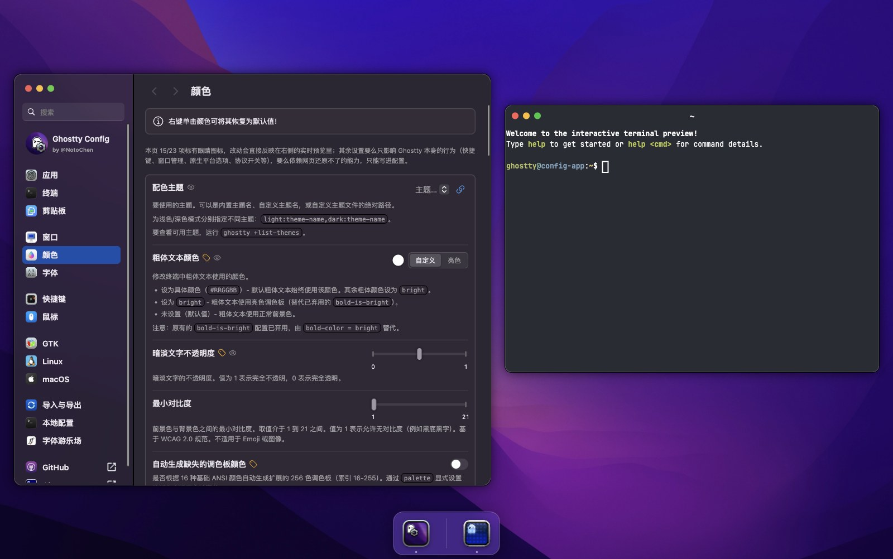
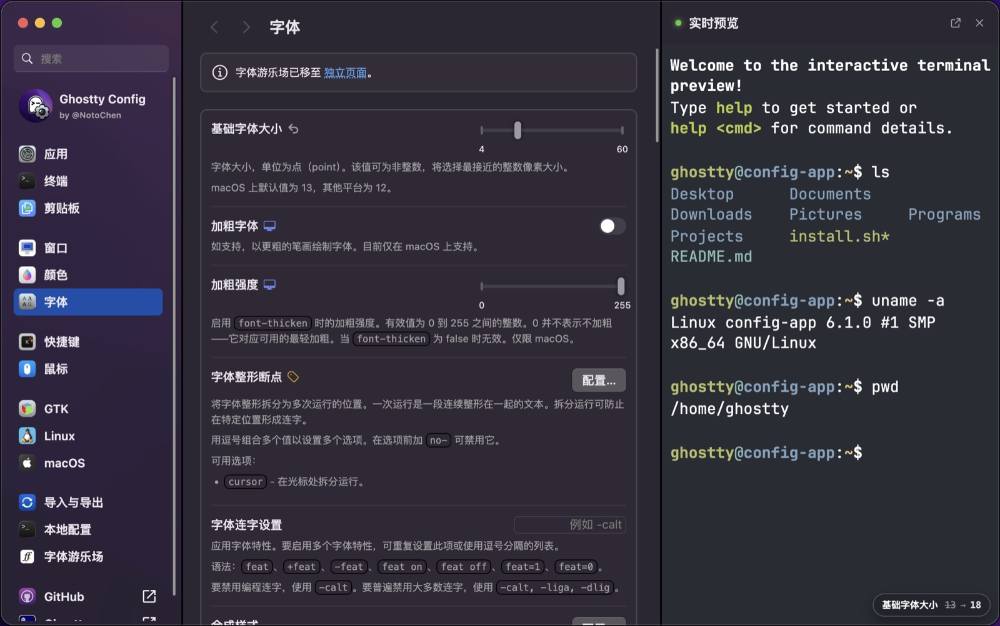
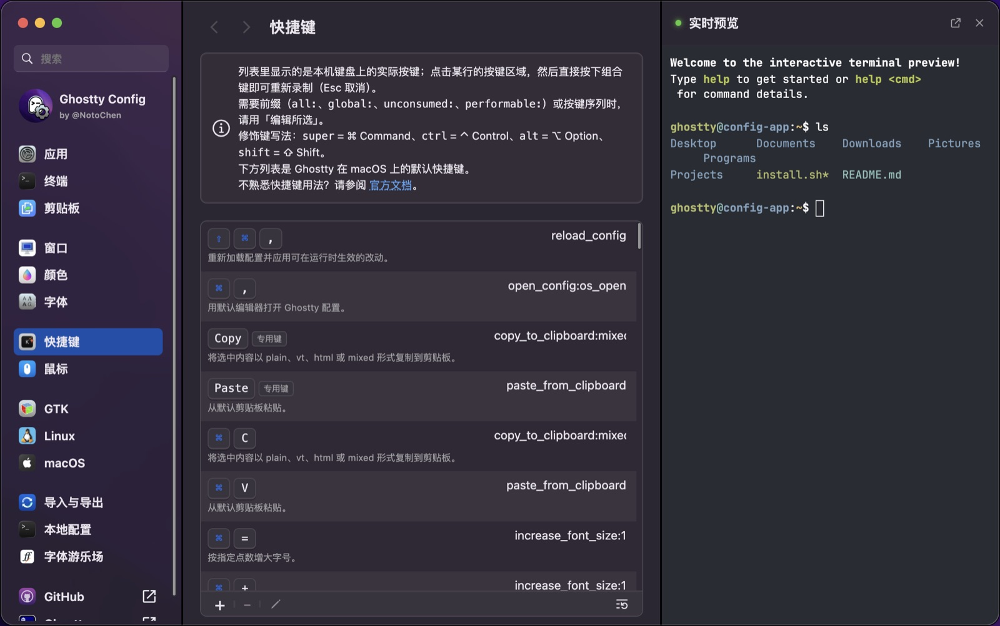
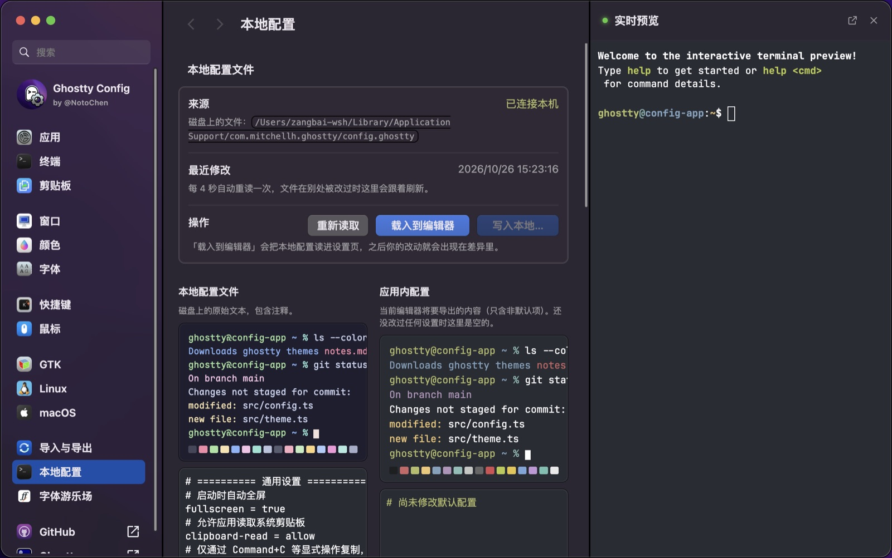

<div align="center">
  <a href="https://notochen.github.io/ghostty-config/"></a>
  <h1 align="center" style="border:0;">Ghostty Config</h1>
  <p align="center">Ghostty 终端的可视化配置生成器 · 全中文界面</p>

[](https://github.com/NotoChen/ghostty-config/actions)
[](https://ghostty.org/)
[](https://svelte.dev)
[](https://notochen.github.io/ghostty-config/)

  
</div>

## 这是什么

Ghostty Config 是一个网页版的 [Ghostty](https://ghostty.org/) 配置生成器：不用手写配置文件，点几下就能改字体、配色、光标、透明度和快捷键，改的过程里终端预览会**实时**跟着变，最后导出一份干净的配置。界面默认就是左边设置、右边实时预览的分栏，想看得更细可以把预览弹成可拖动、可缩放的独立窗口。

本项目是在 [zerebos/ghostty-config](https://github.com/zerebos/ghostty-config) 基础上的二次开发（Fork），在原版之上主要做了这些改动：

- **全面中文化**：界面、设置项名称与说明、提示消息、公告文本全部改为中文。
- **对齐 Ghostty 1.4.0**：按 `ghostty +show-config --default` 与 1.4.0 的配置规范逐项核对，共 211 个配置键，外加 `quick-terminal-size`。
- **快捷键改成「真实按键」**：列表里显示的是键盘上实际按的键（⌘ ⇧ ⌃ ⌥ / T），而不是 `super+shift+comma` 这种写法；点击某行按键区域后直接按下组合键即可录入，编辑器里按下组合键也会自动勾选修饰键。
- **快捷键作用说明**：每一行下方用中文说明这个操作的用途。
- **本地配置对比**：一边是你机器上真实的配置文件，一边是应用内正在编辑的配置，逐项列出差异；写回时自动备份、自动校验、自动按功能模块分组加中文注释。
- **在线版也能处理本地配置**：静态部署没有磁盘访问权限，所以支持**上传配置文件**或**粘贴配置文本**，对比、合并、注释分组的能力完全一致，最后下载合并结果替换原文件即可。
- **默认左右分栏，改动能看见**：设置项在左、实时预览在右。每改一项，预览区会浮出一条提示，写明改的是哪一项、从什么改成了什么（调色板会精确到第几个色位），预览同时闪一下高亮，已经渲染出来的内容原地换肤，不会被清屏。
- **预览范围写成明账**：能在网页里还原的设置（颜色、字体、光标、内边距、透明度、模糊、背景图、滚动条等）行首标一个眼睛图标，每页顶部写明「本页 N/M 项可预览」；快捷键、窗口管理、GTK / macOS 原生行为这类只能写进配置的项目不再让人以为预览坏了。背景图、自定义图标这类指向本机文件的设置，网页只能加载网络 URL，本地路径在预览里不会显示。

**在线体验：** [notochen.github.io/ghostty-config](https://notochen.github.io/ghostty-config/)


## 支持的 Ghostty 版本

**Ghostty 1.4.0。**

版本号不是按本项目自己的发版节奏走的，而是**与所支持的 Ghostty 版本保持一致**：`package.json` 的 `version`、`src/lib/data/version.ts` 里的 `GHOSTTY_VERSION` 都等于 `1.4.0`。这样看到一个版本号就知道这份配置对得上哪个 Ghostty。上游 Ghostty 发布新版本、设置项重新核对之后，这两处会一起改。

需要说明的几点：

- **`link` 键没有收录**：Ghostty 1.4.0 已经移除了它，`ghostty +validate-config` 会直接报错，所以本工具不再提供。
- **每个设置项都带版本与平台标记**：需要 macOS / Linux / GTK 的设置、从哪个版本开始出现，都会在对应行上标注。
- **旧配置可以直接读**：`scrollback-limit` 等 1.4.0 改名的键在导入时会自动迁移；不认识的键会在对比表里标为「不识别」，合并时原样保留、不会被删掉。


## 功能

- **交互式设置编辑**：字体、配色、光标、透明度、模糊、内边距等，按面板和功能分组。
- **贴合类型的输入控件**：滑块、联动的双数字输入、取色器、时长输入、特性列表等，每个设置项都用最合适的控件。
- **几百套内置主题**：与上游 iTerm2 Color Schemes 自动同步，选中即可实时预览。
- **字体游乐场**：试用 JetBrains Mono、Nerd Font 或任意自定义字体，直接看到效果。
- **实时预览**：光标、选区、应用图标、调色板都会随编辑即时更新；字体粗体/斜体、字距行高、内边距、背景透明度与模糊、背景图、滚动条显隐同样会被还原。
- **可交互的终端预览**：基于 DOM 的终端模拟，可以直接输入命令；改配色时已经渲染出来的内容会原地换肤，不会被清屏。
- **默认左右分栏**：设置项在左、预览在右；分隔条可以拖动调宽窄，宽度会被记住。预览也可弹出成独立窗口（可拖动、可缩放），再停靠回来时滚动内容和命令历史都还在。
- **改动提示**：每改一项，预览区浮出一条「设置名 · 原值 → 新值」，预览同时闪一下高亮，不用自己比对改了什么。
- **快捷键编辑器**：支持前缀（`all:` / `global:` / `unconsumed:` / `performable:`）、按键序列、修饰键勾选与实时校验。
- **导入与导出**：支持粘贴、上传、复制、下载和分享链接；导出时只包含与默认值不同的项。
- **逐项内联说明**：每个设置项下方直接写清它是什么、怎么填，不需要点开帮助。
- **侧边栏搜索**：像 macOS 系统设置一样，直接搜到任意设置并跳转。
- **单项恢复默认**：任何一项都能一键还原。


## 界面

**字体**——拖动字号滑块，预览里已经渲染出来的内容立刻按新字号重排，同时提示条写明 `13 → 18`：



**快捷键**——列表里显示的是键盘上实际按的键（⌘ ⇧ ⌃ ⌥），点一下就能重新录制：



**本地配置**——磁盘上的真实文件和编辑器里正在改的配置并排对照，逐项列出差异：




## 本地运行

需要 [Bun](https://bun.sh) ≥ 1.3。

```bash
git clone https://github.com/NotoChen/ghostty-config.git
cd ghostty-config
bun install
bun run dev
```

打开终端里提示的 `http://localhost:5173`。

常用命令：

```bash
bun run build    # 生产构建，产物在 build/
bun run preview  # 本地预览生产构建
bun run check    # Svelte + TypeScript 类型检查
bun run lint     # ESLint
bun run test     # Vitest 单元测试
```

> 这台机器上如果没有 Bun，把上面的 `bun` 换成 `npx` 也能跑，例如 `npx vite dev`、`npx svelte-check`。


## 「本地配置」页面

这个页面把**你磁盘上的配置文件**和**应用内正在编辑的配置**并排放在一起，逐项列出差异，并能把应用内的改动合并回去。

### 本机运行：直接读写磁盘

用 `bun run dev`（或 `bun run preview`）启动时，Vite 开发服务器提供一个只在回环地址上可用的桥接接口 `GET/POST /__ghostty/local-config`，用来读写本机的 Ghostty 配置：

- 每 4 秒自动重读一次文件，文件在别处被改过时页面会跟着刷新。
- 写回前**一定**先备份为 `*.bak-时间戳`，再通过 `.tmp` 文件 + 重命名写入，中途崩溃也不会留下半截文件。
- 写入前用你本机的 `ghostty +validate-config` 校验；如果文件里本来就有非法行，只要这次写入没有新增非法行就允许写入。
- 只写应用内的非默认项；文件里你没载入过的自定义项原样保留。

出于安全考虑，这个接口只监听回环地址、拒绝非 `localhost` 来源的请求，也从不添加 CORS 头。`vite build` 不会生成该接口，**线上部署的版本没有文件访问能力**。

### 在线版：上传或粘贴

静态部署（GitHub Pages）读不到磁盘，所以页面会改为让你**上传配置文件**或**粘贴配置文本**。文件只在浏览器里读取，不会上传到任何服务器；之后的对比、合并选项、注释分组、差异预览都和本机运行一致，只是最后一步从「直接写回磁盘」变成「下载合并后的文件」，由你自己替换 `~/.config/ghostty/config`（macOS 上是 `~/Library/Application Support/com.mitchellh.ghostty/config.ghostty`）。从非本机地址打开时页面也不会去请求本机桥接接口，所以控制台不会出现无意义的 404。

配置文件的位置：

| 系统 | 路径 |
|------|------|
| macOS | `~/Library/Application Support/com.mitchellh.ghostty/config.ghostty`（旧版本为 `config`） |
| Linux | `~/.config/ghostty/config` |

如果只是想把自己的配置带进编辑器，用「导入与导出」页的粘贴 / 上传即可，不必走这个页面。


## 部署

仓库自带两个 GitHub Actions 工作流：

- `.github/workflows/ci.yml`：跑单元测试、类型检查、Lint 和构建。
- `.github/workflows/pages.yml`：推送到 `main` 后构建并发布到 GitHub Pages。

GitHub Pages 的项目站点在 `https://<用户名>.github.io/<仓库名>/` 下，因此构建时会把 `BASE_PATH` 设为 `/<仓库名>`。本地 `bun run dev` / `bun run preview` 始终使用空 base，回环桥接不受影响。仓库改名后无需手改代码，工作流用的是 `github.event.repository.name`。

首次使用时，在仓库的 **Settings → Pages → Build and deployment → Source** 里选择 **GitHub Actions**。

也可以完全自托管：`bun run build` 之后把 `build/` 目录丢到任意静态服务器上即可。


## 技术栈

- [Svelte 5](https://svelte.dev)（runes）+ [SvelteKit](https://kit.svelte.dev)：界面与静态站点生成
- [TypeScript](https://www.typescriptlang.org/)：设置项注册表由类型驱动，`satisfies` 保证 `default` 与控件类型对得上
- [Vite](https://vite.dev/)：开发服务器与构建
- [Bun](https://bun.sh)：包管理与脚本运行
- [GitHub Pages](https://pages.github.com/)：在线版托管

设置系统由三份文件构成：`settings/types.ts`（数据结构）→ `settings/registry.ts`（每个配置键、默认值、控件）→ `settings/navigation.ts`（侧边栏位置）。三者必须保持同步，导航校验会在开发启动时直接抛错。


## 参与开发

见 [CONTRIBUTING](./CONTRIBUTING.md)。提交前请确保 `bun run check`、`bun run lint`、`bun run test` 三项全部通过。


## 许可证与致谢

以 [Apache-2.0](./LICENSE) 协议开源，与原项目保持一致。

- 原始项目：[zerebos/ghostty-config](https://github.com/zerebos/ghostty-config)，作者 [@Zerebos](https://github.com/zerebos)。本仓库保留其版权声明。
- 主题数据来自 [iTerm2-Color-Schemes](https://github.com/mbadolato/iTerm2-Color-Schemes/)。
- 感谢 [Ghostty](https://ghostty.org/) 以及它的作者 Mitchell Hashimoto。

如果这个工具对你有用，欢迎给[原项目](https://github.com/zerebos/ghostty-config)点个 Star。
